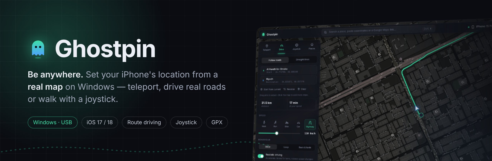
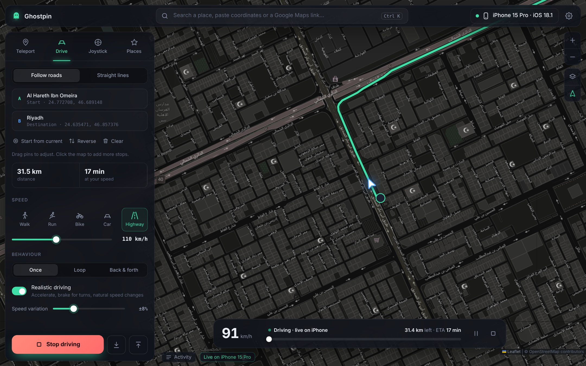
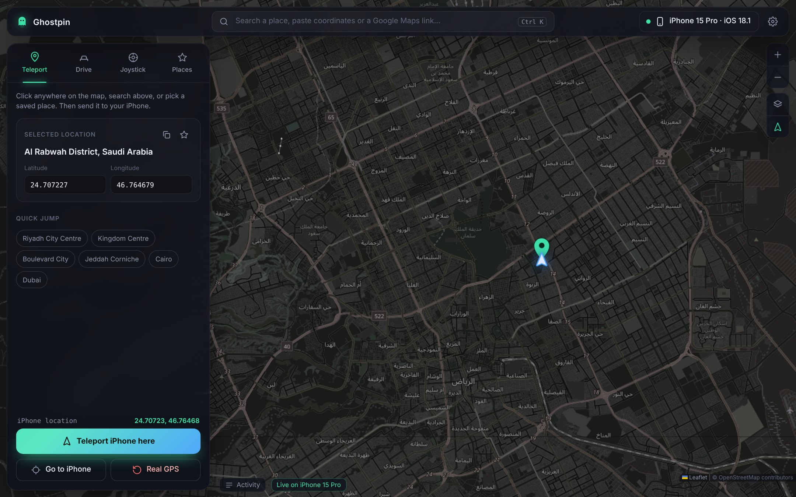
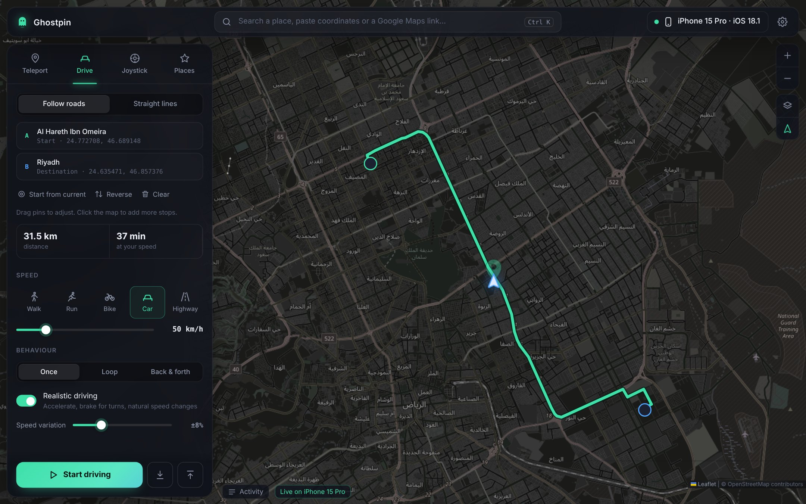
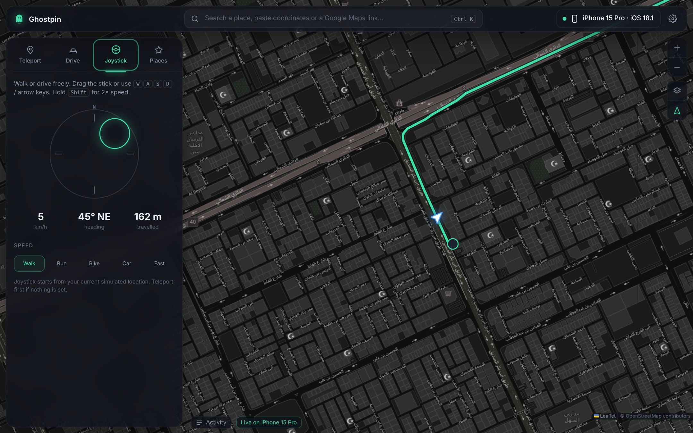
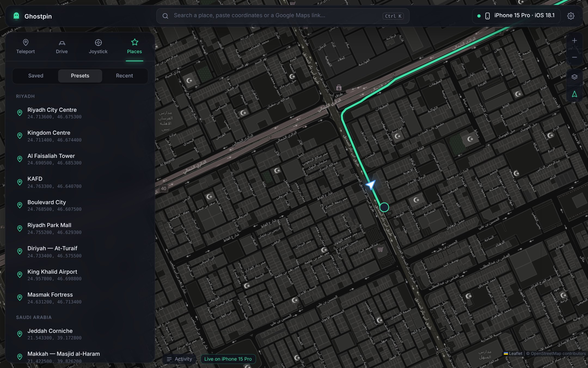
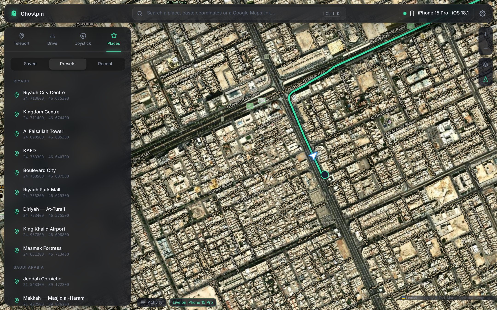
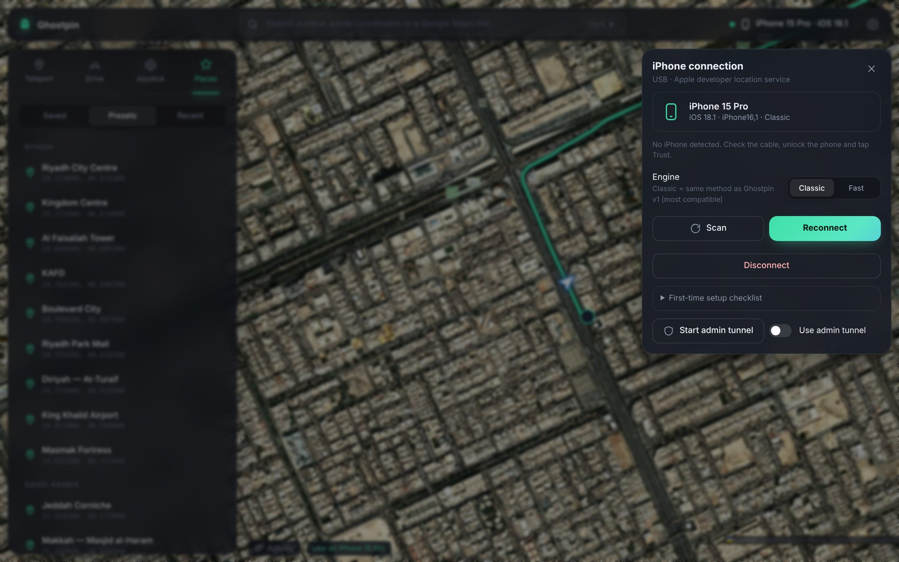
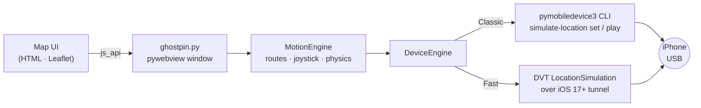

<p align="center">
  
</p>

<p align="center">
  <a href="https://github.com/Omar-Raslan-16006931/ghostpin/releases/latest"></a>
  
  
  <a href="LICENSE"></a>
</p>

<p align="center">
  <b>Be anywhere.</b> <b>Teleport</b> anywhere · <b>drive real roads</b> at any speed · <b>walk with a joystick</b> — over USB, from a desktop map.
</p>

<p align="center">
  
</p>

---

## Contents

- [Features](#features)
- [Download](#download)
- [Setup](#setup)
- [Screenshots](#screenshots)
- [Keyboard shortcuts](#keyboard-shortcuts)
- [How it works](#how-it-works)
- [Troubleshooting](#troubleshooting)
- [Build from source](#build-from-source)
- [Use it responsibly](#use-it-responsibly)

## Features

| | |
|---|---|
| 🗺️ **Real map** | Dark, street, satellite and hybrid maps. Click anywhere or drag the pin to choose a spot. |
| 🔎 **Smart search** | Place names, raw coordinates (`24.7136, 46.6753`) or pasted Google Maps links. |
| 📍 **Teleport** | One click moves the iPhone. Shows the street address and asks before huge jumps. |
| 🚗 **Drive mode** | A → B with any number of stops along real roads (car, bike or foot routing), with alternative routes to pick from. |
| 🎛️ **Realistic motion** | Smooth acceleration, braking before turns and natural speed variation. Speed from 1 to 250 km/h, adjustable while driving. |
| 🔁 **Playback controls** | Once, loop or back-and-forth. Pause, resume, stop, and scrub the progress bar. Live speed, distance left and ETA. |
| 🕹️ **Joystick** | On-screen stick or `WASD` / arrow keys. Hold `Shift` for 2× speed. |
| ⭐ **Places** | Saved favourites, recent history, and presets for Riyadh, Saudi Arabia, Egypt and world cities. |
| 📄 **GPX** | Import a GPX track and drive it, or export any route. |
| 👀 **Preview mode** | Everything works on the map without a phone, so you can plan before connecting. |
| ↩️ **Real GPS** | Restore the phone's real location in one click, or automatically on exit. |

## Download

1. Grab **`Ghostpin.exe`** from the [latest release](https://github.com/Omar-Raslan-16006931/ghostpin/releases/latest). It's one file and needs no install.
2. Windows SmartScreen may warn about an unsigned app. Click **More info → Run anyway**.

## Setup

> One-time setup. After this you just plug in and click **Connect**.

1. Install **Apple Devices** (Microsoft Store) or **iTunes** so Windows can talk to the iPhone.
2. Connect the iPhone with a **data** cable, unlock it and tap **Trust**.
3. On the iPhone, open **Settings › Privacy & Security › Developer Mode**, turn it **On** and restart.
4. In Ghostpin, click the phone button (top right) and then **Connect**.
   The first connection mounts Apple's developer disk image and needs internet.

### Engines

| Engine | How it works | Best for |
|---|---|---|
| **Classic** (default) | Runs `pymobiledevice3 developer dvt simulate-location`. It uses your own Python install if it has pymobiledevice3, otherwise the copy inside the exe. Drives are replayed on the phone as a timed GPX. | Maximum compatibility |
| **Fast** (beta) | Keeps one live developer connection open and streams every position. | Smoother joystick |

## Screenshots

<table>
  <tr>
    <td width="50%"><p align="center"><b>Teleport</b> — pick a spot, see the address, send it</p></td>
    <td width="50%"><p align="center"><b>Route planning</b> — stops, real roads, distance and time</p></td>
  </tr>
  <tr>
    <td><p align="center"><b>Joystick</b> — walk or drive freely with WASD</p></td>
    <td><p align="center"><b>Places</b> — saved, recent and presets</p></td>
  </tr>
  <tr>
    <td><p align="center"><b>Hybrid map</b> — satellite imagery with labels</p></td>
    <td><p align="center"><b>Connection</b> — device, engine and setup checklist</p></td>
  </tr>
</table>

## Keyboard shortcuts

| Key | Action |
|---|---|
| `Ctrl` `K` | Search |
| `T` | Teleport to the selected pin |
| `Space` | Pause / resume driving |
| `Esc` | Stop moving / close panels |
| `1` – `4` | Switch tabs |
| `W` `A` `S` `D` / arrows | Joystick (`Shift` = 2× speed) |

## How it works



- **Map and search:** OpenStreetMap tiles, Esri imagery, Nominatim geocoding.
- **Routing:** OSRM via `routing.openstreetmap.de` (car, bike, foot).
- **Device:** [pymobiledevice3](https://github.com/doronz88/pymobiledevice3) talks to Apple's developer location service, the same one Xcode uses.

## Troubleshooting

<details>
<summary><b>"No iPhone found"</b></summary>

Use a data cable (not charge-only), unlock the phone, tap **Trust**, and make sure Apple Devices or iTunes is installed.
</details>

<details>
<summary><b>Connected, but the location doesn't change</b></summary>

- Check that Developer Mode is on and the phone was restarted after enabling it.
- Open **Activity** (bottom left) to see the exact error.
- Switch the engine (Classic ↔ Fast) in the iPhone panel and click **Reconnect**.
- The full log is at `%APPDATA%\Ghostpin\ghostpin.log`.
</details>

<details>
<summary><b>Stuck on the loading screen</b></summary>

Install the [Microsoft Edge WebView2 Runtime](https://developer.microsoft.com/microsoft-edge/webview2/). It ships with Windows 11 and most Windows 10 PCs.
</details>

<details>
<summary><b>Map or search is blank</b></summary>

Map tiles, search and routing need an internet connection.
</details>

## Build from source

```bat
:: run directly (Python 3.11+)
run_from_source.bat

:: build dist\Ghostpin.exe
build_exe.bat
```

Pushing a `v*` tag builds the exe on GitHub Actions and attaches it to the release.

```
ghostpin.py    app window, JS bridge, GPX, settings
engine.py      DeviceEngine (Fast) + MotionEngine (routes, joystick, physics)
classic.py     Classic engine (pymobiledevice3 CLI)
web/           UI: index.html, app.css, app.js, Leaflet
```

## Use it responsibly

Ghostpin is for development, testing and personal use. It only changes the GPS location reported to apps. It doesn't change your IP address, carrier or Apple Account region. Don't use it to cheat in games, fake attendance, or mislead people or services. That can break their terms and, in some cases, the law.

## Credits

[pymobiledevice3](https://github.com/doronz88/pymobiledevice3) · [pywebview](https://github.com/r0x0r/pywebview) · [Leaflet](https://leafletjs.com) · [OpenStreetMap](https://www.openstreetmap.org/copyright) · [OSRM](https://project-osrm.org) · Esri World Imagery

<p align="center"><br><sub>MIT © Omar Raslan</sub></p>
